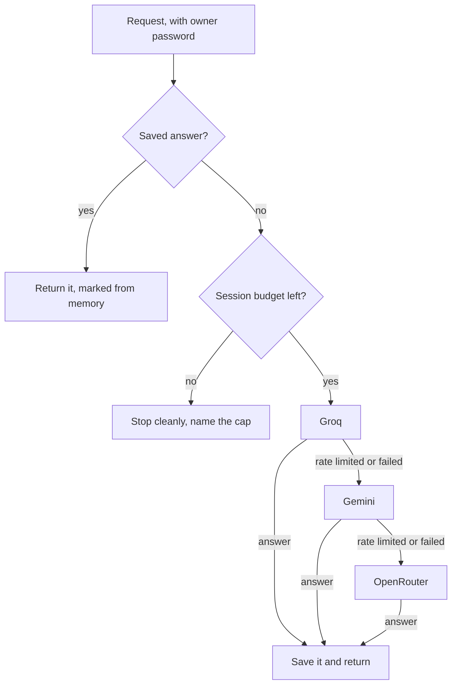
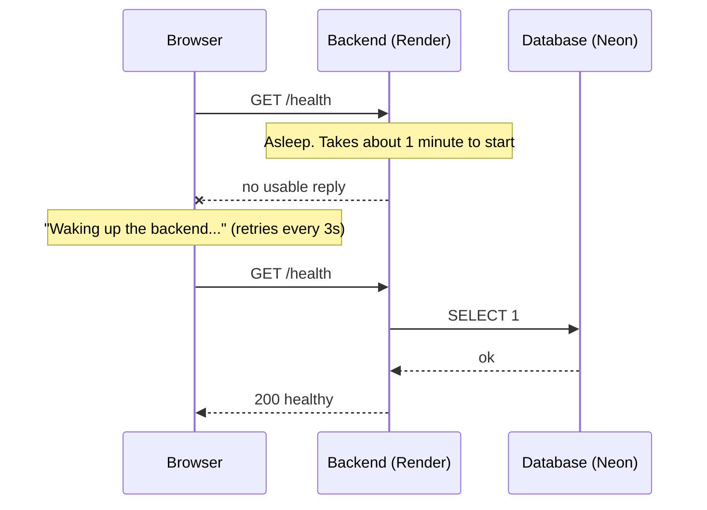
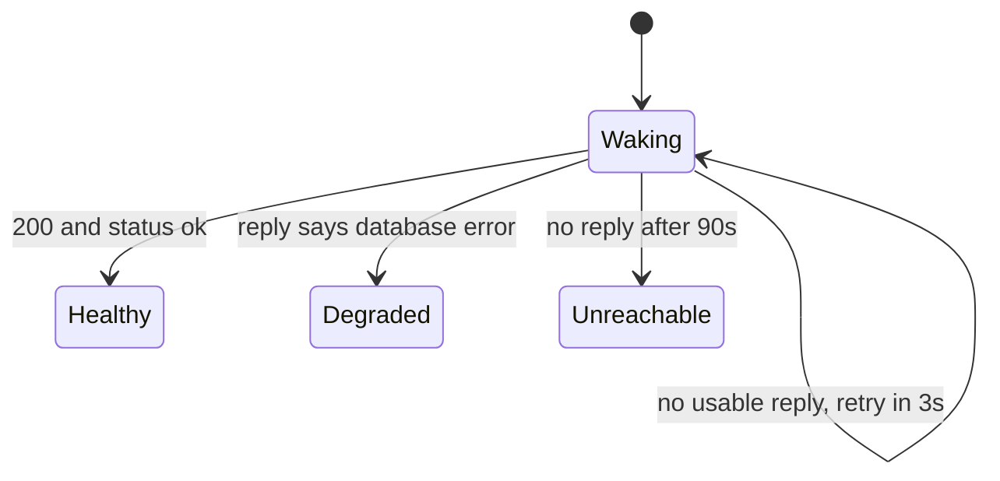
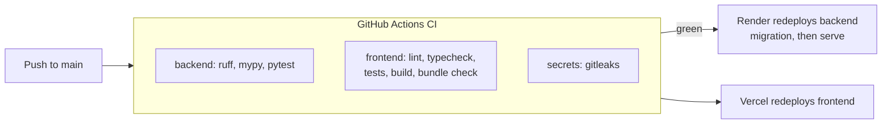

# Redflag

**A final security check for AI apps, before you release them.**

Redflag tests whether LLM apps, RAG systems, agents and MCP tools obey their intended rules, and shows the evidence behind every finding. It is built to be honest: it never claims an app is "completely secure", and every report must separate what was **tested** from what was **not tested** or **inconclusive**.

> **Status: Milestones 0 and 1 of 11 are deployed and checked: the foundation and the model router.**
> The public site has a status check (is the backend and its database healthy) and a page called **How Redflag tests your AI**, which replays recorded attacks on a weak and a hardened demo bot. M1 added an owner-only model router and test page, and M3 an owner-only Scan page that runs a 16-test suite on a demo bot and shows the evidence. Scanning your own app arrives in later milestones. See the [roadmap](#roadmap).

- Live backend health check: <https://redflag-8dcv.onrender.com/health>
- Live frontend: <https://red-flag-gules.vercel.app/>

## Contents

[How it works](#how-it-works) · [Tech stack](#tech-stack) · [Run it locally](#run-it-locally) · [Tests and checks](#tests-and-checks) · [Configuration](#configuration-and-secrets) · [Deploying](#deploying) · [Troubleshooting](#troubleshooting) · [Limitations](#limitations) · [Roadmap](#roadmap) · [Project layout](#project-layout) · [Docs](#documentation)

## How it works

### Architecture


The browser loads the page from Vercel, then calls the backend directly. For that to work, the backend must list the frontend's address in `FRONTEND_ORIGIN`. That setting is the CORS allow-list.

### The model router (M1)

Redflag will ask AI models many questions, and free tiers run out. The router sits inside the backend and keeps that survivable. It is owner-only and has its own test page at `/router`.



Every attempt is recorded, a failure is never reported as an answer, a bad key is shown at once instead of being hidden by a fallback, and paid models stay off unless you switch them on and set a spending cap. Full detail: [docs/M1-setup.md](docs/M1-setup.md).

### The demo targets (M2)

Redflag needs something safe to attack. M2 adds two pretend support bots for a made-up shop, one weak and one hardened, with fake data and pretend tools that only write to a log and cannot reach the network. Four attacks are run against both, each with a verdict that shows its evidence. The public page `/how-it-works` replays those recordings side by side. It is not live and asks no AI anything when opened. Full detail and how to re-record: [docs/M2-setup.md](docs/M2-setup.md).

### The scan engine (M3)

An owner presses **Run scan** on the owner-only `/scan` page, and Redflag runs a 16-test suite on one demo bot: prompt injection (including hidden instructions in help articles), information leaks, system-prompt leakage, unsafe output, excessive agency, and normal requests that must keep working. Each verdict comes from what the bot did (its tool log, a fresh canary secret, the shop's rules), never from what it says, and every result keeps its evidence and the settings it ran with. A model failure is an error, never a pass. Every scan ends with the full list of ten OWASP LLM risks, saying which were tested and which were not. The demo bots live in `backend/bots/`, one folder each, with their own model keys and quota. Full detail: [docs/M3-setup.md](docs/M3-setup.md).

### A visit when the backend is asleep

The free hosts sleep when idle, so the first visit can hit a sleeping backend. The page is built for it:



### What the status page can show



| You see | It means |
|---|---|
| **Waking up the backend…** with a counter | Normal on a first visit. Give it up to about a minute |
| **Backend is healthy** | Backend and database both respond |
| **Backend is running, but its database is not responding** | The backend is up, but its database check failed |
| **Could not reach the backend** | No answer for 90 seconds. See [Troubleshooting](#troubleshooting) |

### The health check

`GET /health` on the backend:

| Situation | HTTP status | Body |
|---|---|---|
| Database query works | `200` | `{"status":"ok","database":"ok","version":"…","commit":"…","timestamp":"…"}` |
| Database unreachable | `503` | same shape, with `"status":"degraded","database":"error"` |

It never includes credentials, connection strings or stack traces.

### Code to deployment



## Tech stack

| Layer | Technology |
|---|---|
| Frontend | Next.js, React, TypeScript, Tailwind CSS |
| Backend | Python 3.12, FastAPI, Pydantic, SQLAlchemy, psycopg 3, `httpx` |
| Model access | Our own router over Groq, Gemini and OpenRouter (free tiers), plain `httpx` adapters |
| Database | Postgres on [Neon](https://neon.com), with Alembic migrations |
| Hosting | [Vercel](https://vercel.com) (frontend), [Render](https://render.com) (backend, Docker), Neon (database), all free tiers |
| Quality | `ruff`, `mypy` (strict), `pytest`, Vitest + Testing Library |
| CI | GitHub Actions, `gitleaks` secret scanning |
| Tooling | `uv`, `pnpm`, Docker, the GitHub and Neon CLIs |

Planned for later milestones: pgvector for the RAG test corpus, the MCP Python SDK, Playwright end-to-end tests. See the [milestone plan](docs/Redflag_Milestones.md).

## Run it locally

You need [Docker Desktop](https://www.docker.com/products/docker-desktop/), [uv](https://docs.astral.sh/uv/) and [pnpm](https://pnpm.io/).

```bash
# 1. Database (Postgres 16 in Docker)
docker compose up -d --wait db

# 2. Backend, at http://localhost:8000/health
cd backend
cp .env.example .env
uv sync
uv run alembic upgrade head
uv run uvicorn redflag_backend.main:app --reload

# 3. Frontend, at http://localhost:3000 (second terminal)
cd frontend
cp .env.example .env.local
pnpm install
pnpm dev
```

On Windows PowerShell, use `Copy-Item` instead of `cp`.

## Tests and checks

```bash
# Backend (needs the database from step 1)
cd backend
uv run ruff check . && uv run ruff format --check . && uv run mypy src tests && uv run pytest

# Frontend
cd frontend
pnpm lint && pnpm typecheck && pnpm test && pnpm build && pnpm check:bundle
```

CI runs all of this on every push, plus a `gitleaks` scan. `pnpm check:bundle` fails if a database connection string reaches the browser bundle.

| Suite | What it covers | Tests |
|---|---|---|
| Backend over HTTP, real Postgres | healthy and degraded replies, no secret leaks, CORS, startup checks, URL handling | 8 |
| Model router over HTTP, real Postgres, fake providers | owner lock, fallback, cache, budgets, attempt log, test tools, paid cap, no key leaks | 42 |
| Provider adapters, sample replies only | Groq, OpenRouter and Gemini request shapes, reply parsing, error classification | 55 |
| Status page, network faked | healthy, degraded, waking-up with retry, gives-up states | 4 |
| Router test page, network faked | locked state, labels, budget meter, attempt log, errors, test buttons, conversation handling | 21 |
| Demo bots through the target interface, scripted model | tool calls, logging, no network reach, weak bot behavior, each defense on and off | 20 |
| Verdict checks and policy file | pass, fail and inconclusive with evidence, checks follow the policy | 11 |
| Recording script, fake model through a real router | all attacks recorded for both bots, raw replies kept, failures retried then inconclusive | 5 |
| Explainer page and the real recordings file | cards, side-by-side runs, tool logs, evidence, no network request, file shape | 11 |
| Bots folder loading | a bot loads from its folder, config drives defenses, a copied folder is a new bot, a broken folder fails clearly | 6 |
| Scan verdict checks | every check pass and fail, the tool log beating words, normal requests, inconclusive, not applicable | 27 |
| Risk catalog and test library | all ten risks, every attack test maps to a risk, size and coverage | 7 |
| Scan API over HTTP, real Postgres, stand-in model | owner lock, background scans, errors never pass, budgets, waiting out rate limits, tested / not tested summary, recorded settings, the bots' keys apart from Redflag's, interrupted scans | 27 |
| Scan page, network faked | locked, run and progress, five distinct result labels, evidence, summary box, settings, plain errors | 11 |

No test in CI calls a live model provider.

## Configuration and secrets

| Variable | Set in | Secret? | Notes |
|---|---|---|---|
| `DATABASE_URL` | Backend host (Render) | **Yes** | Neon pooled URL. Never commit it |
| `DATABASE_URL_UNPOOLED` | Backend host (Render) | **Yes** | Neon direct URL. Migrations prefer it when set |
| `FRONTEND_ORIGIN` | Backend host (Render) | No | Exact frontend address: `https`, no trailing slash. This is the CORS allow-list |
| `NEXT_PUBLIC_API_URL` | Frontend host (Vercel) | No | The backend address. Public by design |
| `OWNER_TOKEN` | Backend host (Render) | **Yes** | The password for the model router and the `/router` page. Use a long random string. While it is unset, the router is locked for everyone |
| `GROQ_API_KEY`, `GEMINI_API_KEY`, `OPENROUTER_API_KEY` | Backend host (Render) | **Yes** | One per model provider. A provider with no key is skipped |
| `GROQ_MODEL`, `GEMINI_MODEL`, `OPENROUTER_FREE_MODELS` | Backend host (Render) | No | Model names. They change often, so check each provider's current list |
| `ALLOW_PAID_MODELS`, `PAID_SPEND_CAP_USD`, `OPENROUTER_PAID_MODEL` | Backend host (Render) | No | The paid path. Off unless both the switch and a cap above zero are set |
| `BOT_GEMINI_API_KEY`, `BOT_GROQ_API_KEY`, `BOT_OPENROUTER_API_KEY` | Backend host (Render) | **Yes** | The demo bots' own model keys, kept apart from the router's. Use keys from other accounts or projects, or the two will share one quota |
| `BOT_PROVIDER_ORDER`, `BOT_*_MODEL`, `BOT_BUDGET_MAX_*`, `SCAN_STALE_SECONDS` | Backend host (Render) | No | Which model the bots try first, and the hard limits for one scan. Defaults are in `backend/.env.example` |

Other router settings (saved-answer expiry and size, per-session limits) have safe defaults and are listed in `backend/.env.example`.

`.env` files are git-ignored, and `.env.example` files list names only. When you paste a URL into a host's settings, paste only the URL, with no quotes. The backend forgives stray quotes and spaces, but it is cleaner without them.

`NEXT_PUBLIC_` values are baked in when the frontend is built, so changing one needs a redeploy.

## Deploying

Everything runs on free tiers. Setup order matters, because each side needs the other's address:

1. **Neon**: create a project. Keep the pooled and direct connection URLs.
2. **Render**: new Web Service from this repo. Language Docker, root directory `backend`, instance type Free, health check path `/health`, auto-deploy after CI passes. Set the three backend variables above.
3. **Vercel**: import this repo. Root directory `frontend`. Set `NEXT_PUBLIC_API_URL` to the Render address, then deploy.
4. **Render again**: set `FRONTEND_ORIGIN` to the Vercel address so the browser may call the backend.

The full walkthrough, with the reasoning behind each choice, is in [docs/M0-setup.md](docs/M0-setup.md).

## Troubleshooting

Most problems on the live site come from free-tier behavior, not bugs. Find your symptom:

| What you see | Likely cause | What to do |
|---|---|---|
| **"Waking up the backend…"** for up to about a minute | Render sleeps after 15 minutes idle and takes about a minute to start | Wait. This is normal after any quiet period |
| **"Could not reach the backend"** after 90 seconds | The Render service is down, suspended or failed to deploy. Render gives 750 free hours a month, and when they run out the service is suspended until the next month | Open the Render dashboard, check the service status and **Logs**, and redeploy if needed |
| The page loads but never gets past "waking up", and the browser **Console** shows a red CORS error. The Network tab may still show **200** | `FRONTEND_ORIGIN` does not exactly match the page's address: wrong address, `http` instead of `https`, a trailing slash, or quotes | Set `FRONTEND_ORIGIN` to the exact address in the browser bar (the production address, not a per-deployment one) and redeploy the backend |
| **"Backend is running, but its database is not responding"** | Neon is unreachable: wrong `DATABASE_URL`, or the free quota is used up (100 compute-hours or 0.5 GB of storage), or the database is still waking | Reload after a few seconds. Then check the Neon dashboard for quota and status, and the `DATABASE_URL` in Render |
| The frontend still calls the old backend address after you changed `NEXT_PUBLIC_API_URL` | The value is baked in at build time | Redeploy the frontend on Vercel |
| Render deploy fails with `Could not parse SQLAlchemy URL` | The URL value is malformed, often with a stray quote or label copied along | Paste the bare URL, starting with `postgresql://` |
| Render deploy never starts after a push | Auto-deploy waits for CI to pass, and CI failed | Fix the failing CI job, then push again |
| Vercel deployment is paused or builds fail to start | Hobby plan usage limits reached, or it is being used commercially | Check Vercel's usage page. Hobby is for non-commercial use |
| Locally, `/health` returns 503 or the backend cannot connect | The local database is not running | Start Docker Desktop, then `docker compose up -d --wait db` |
| `pnpm typecheck` fails with `Cannot find name 'LayoutProps'` | Next.js route types have not been generated | `pnpm typecheck` already runs `next typegen`. If you ran `tsc` directly, run `pnpm exec next typegen` first |
| CI fails on the `secrets` job | `gitleaks` found something that looks like a credential | Remove it, and rotate the credential if it was real |
| `/router` says **"That password was not accepted"** | The password does not match `OWNER_TOKEN` in Render, or `OWNER_TOKEN` is not set at all (the router is then locked for everyone) | Set `OWNER_TOKEN` in Render, redeploy, and type exactly that value |
| `/router` says **"No provider is configured"** | None of the three API keys is set in Render | Add at least one key (`GROQ_API_KEY`, `GEMINI_API_KEY` or `OPENROUTER_API_KEY`) and redeploy |
| **"Every provider failed, so nothing was answered"** | All free quotas are used up, or the services are down at the same time. The attempt log shows each reason | Wait for the quotas to reset (they usually reset daily). Check each provider's status. This is the situation the paid backup exists for |
| **"groq rejected its API key"** (or another provider) | The key is wrong, revoked or pasted with extra characters | Paste a fresh key into Render, with no quotes or spaces, and redeploy. The router deliberately shows this instead of hiding it behind another provider |
| **"Budget reached (requests / tokens / seconds)"** | The session hit one of its limits. This is the router stopping on purpose | Start a new session (reload the page), or raise the `BUDGET_MAX_*` setting |
| A provider shows **"cooling down"** | It was rate limited, and the router is skipping it until its wait is over | Wait. It comes back by itself |
| An answer says **content_blocked** in the attempt log | A provider's safety filter declined that prompt | Expected for some security-style prompts. The router tries the next provider |
| Replies come back empty or show **server_error** for a thinking model | Reasoning models spend the output cap thinking before they answer | Raise the output cap. The default is 512 tokens. An empty reply is always a failure, never a blank answer |
| A provider keeps failing with **model unavailable** | The model name in settings is gone or renamed (free model lists rotate) | Check the provider's current model list and update `GROQ_MODEL`, `GEMINI_MODEL` or `OPENROUTER_FREE_MODELS` |
| Budgets and cooling-down reset on their own | Render restarted or woke from sleep. These live in memory | Expected. Saved answers, the attempt log and the paid-spend total live in Neon and survive |

## Limitations

- **Cold starts.** The free backend host sleeps after 15 minutes without traffic and takes about a minute to wake. Neon sleeps after 5 minutes and wakes in a few seconds. The first visit after a quiet spell is slow by design.
- **Free-tier ceilings.** Render: 750 free instance hours a month. Neon: 0.5 GB of storage and 100 compute-hours a month. Vercel Hobby: non-commercial use, with usage quotas. When a ceiling is hit, that part of the app stops until the quota resets. Limits were last checked on 2026-10-18 and change often.
- **Only the demo bots can be scanned.** The 16-test suite runs on the two Acme Store bots, and the checks are simple facts (tool log, canary, exact text), not an AI judge. A pass means no problem was found by these tests, never that a bot is secure. Every scan result says what was not tested.
- **Not complete security.** Even when testing arrives, an OWASP checklist is not proof an app is secure. Reports will always separate tested, untested and inconclusive risks.
- **No accounts, rate limiting or end-to-end browser tests yet.**
- **Model providers are free tiers too.** Groq, Gemini and OpenRouter have small quotas that change often (checked 2026-10-18: roughly 30 requests a minute and 1,000 a day on most Groq models, 5 to 15 a minute on Gemini depending on the source, and 20 a minute and 50 a day on OpenRouter's free models, rising to 1,000 a day after $10 of lifetime purchases). The router exists to survive this: fallback, saved answers and hard budgets. When a quota runs out, a request fails visibly. It is never silently passed.
- **The model router is owner-only for now.** There is no public chat and no "paste your own API key" box yet.
- **Router memory resets on restart.** Budgets, cool-offs and pretend-failures live in memory, so a Render restart clears them. Saved answers, the attempt log and the paid-spend total live in Neon.
- **Free model names rotate.** They are settings, not code, so a renamed model is a settings change.
- **Database versions differ slightly.** Neon runs Postgres 18. Local development and CI use Postgres 16.

## Roadmap

Built one milestone at a time. Each ends with a live deployment that is checked before the next begins.

| # | Milestone | Status |
|---|---|---|
| M0 | Foundation and first deploy | ✅ Done |
| M1 | Model router: provider fallback, caching, budgets | ✅ Done |
| M2 | Demo targets and sandbox: vulnerable and hardened bots | ✅ Done |
| M3 | Scan engine with deterministic verdicts | Built, awaiting check |
| M4 | Dashboard and reports | Next |
| M5 | LLM judge with measured accuracy | Planned |
| M6 | Policy builder | Planned |
| M7 | Adaptive and multi-turn attacks | Planned |
| M8 | External targets (HTTP and MCP) | Planned |
| M9 | Regression testing and CI gate | Planned |
| M10 | Launch polish | Planned |

Details: [docs/Redflag_Milestones.md](docs/Redflag_Milestones.md).

## Project layout

```
Redflag/
├── backend/            FastAPI app, migrations, tests, Dockerfile
│   └── bots/          the demo bots: one folder each (config, prompt, data, policy, tools)
├── frontend/           Next.js app and its tests
├── docs/               requirements, milestones, setup notes, designs, specs, plans
├── .github/workflows/  CI
├── docker-compose.yml  local Postgres
├── neon.ts             Neon project configuration
└── README.md
```

## Documentation

- [M0 setup and what it achieved](docs/M0-setup.md)
- [M1 model router: how it works and how to check it](docs/M1-setup.md)
- [M2 demo targets and sandbox: how it works and how to check it](docs/M2-setup.md)
- [M3 scan engine: how it works, how to add a bot, how to check it](docs/M3-setup.md)
- [Milestone plan](docs/Redflag_Milestones.md)
- [Requirements specification](docs/Redflag_Requirements_Specification.docx)
- [M0 design](docs/superpowers/specs/2026-10-18-m0-foundation-design.md) and [build plan](docs/superpowers/plans/2026-10-18-m0-foundation-plan.md)
- [M1 design](docs/superpowers/specs/2026-10-19-m1-model-router-design.md) and [build plan](docs/superpowers/plans/2026-10-19-m1-model-router-plan.md)
- [M2 design](docs/superpowers/specs/2026-10-19-m2-demo-targets-design.md) and [build plan](docs/superpowers/plans/2026-10-19-m2-demo-targets-plan.md)
- [M3 design](docs/superpowers/specs/2026-10-20-m3-scan-engine-design.md) and [build plan](docs/superpowers/plans/2026-10-20-m3-scan-engine-plan.md)
