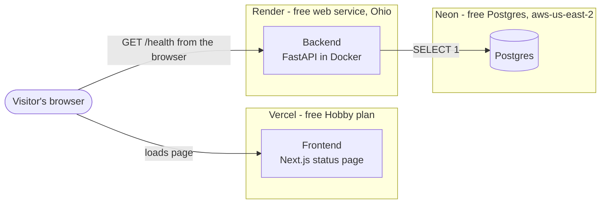
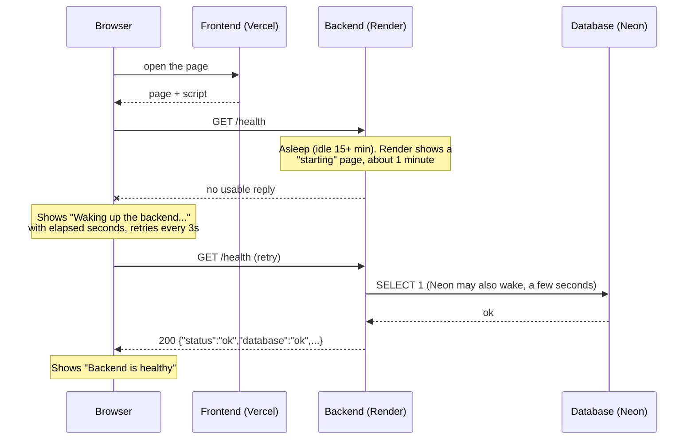
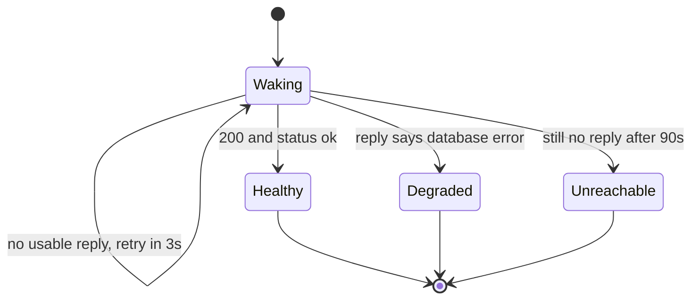
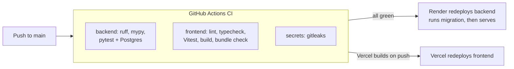

# M0: Foundation and first deploy

**Status: complete and deployed (2026-10-18).** This document records how M0 was set up, why it is built the way it is, and what it achieved. It describes M0 only and will be updated as later milestones change things.

Related documents: [Milestone plan](Redflag_Milestones.md) · [Requirements](Redflag_Requirements_Specification.docx) · [M0 design](superpowers/specs/2026-10-18-m0-foundation-design.md) · [M0 build plan](superpowers/plans/2026-10-18-m0-foundation-plan.md) · [Spec issue #1](https://github.com/BhaveshAnandpara/RedFlag/issues/1)

## 1. What M0 is for

Redflag will be a final security check that AI developers run before releasing an LLM app. Before building any of that, M0 proves the whole free hosting path works end to end, so later features sit on something known to be sound:

> A public page → a deployed backend → a real database, with CI on every push and no secrets leaking.

The product does one thing in M0: a status page that shows whether the backend and its database are healthy.

## 2. Architecture

### 2.1 Components



The browser calls the backend directly. The frontend only serves the page, so the backend must allow the frontend's address through CORS (see `FRONTEND_ORIGIN` below).

### 2.2 What happens when someone opens the page

The free hosts sleep when idle, so the first visit may hit a sleeping backend. The page is built for that.



### 2.3 The four states of the status page



| State | What the visitor sees | Meaning |
|---|---|---|
| Waking | "Waking up the backend…" with a seconds counter | Normal on a first visit. The backend is starting |
| Healthy | "Backend is healthy", database, version, commit | Everything responds |
| Degraded | "Backend is running, but its database is not responding" | Backend is up, database check failed (HTTP 503) |
| Unreachable | "Could not reach the backend" | No answer for 90 seconds |

### 2.4 Code, test and deploy pipeline



Render is set to deploy only after CI checks pass, so a broken push cannot go live on the backend. Vercel builds from the same push.

### 2.5 The health contract

`GET /health` on the backend:

| Situation | HTTP status | Body |
|---|---|---|
| Database query works | `200` | `{"status":"ok","database":"ok","version":"…","commit":"…","timestamp":"…"}` |
| Database unreachable | `503` | same shape with `"status":"degraded","database":"error"` |

The response never contains connection strings, credentials or stack traces. A broken database can never be reported as healthy.

### 2.6 Repository layout

```
Redflag/
├── backend/            FastAPI app, Alembic migrations, tests, Dockerfile
│   ├── src/redflag_backend/   app.py (the /health endpoint), settings.py, main.py
│   ├── migrations/            Alembic (empty baseline migration)
│   └── tests/                 test_health.py
├── frontend/           Next.js app
│   ├── src/app/               page.tsx, layout.tsx
│   ├── src/components/        health-status.tsx (+ its tests)
│   └── scripts/               check-bundle.mjs (secret check)
├── docs/               requirements, milestones, this file, designs, specs, plans
├── .github/workflows/  ci.yml
├── docker-compose.yml  local Postgres for development and tests
├── neon.ts             Neon project configuration
└── README.md
```

## 3. Technology used in M0

| Layer | Choice |
|---|---|
| Frontend | Next.js, TypeScript, Tailwind CSS, `pnpm`, Vitest + Testing Library |
| Backend | Python 3.12 (pinned with `uv`), FastAPI, Pydantic settings, SQLAlchemy, psycopg 3 |
| Migrations | Alembic |
| Database | Postgres on Neon (local development uses Postgres 16 in Docker) |
| Quality | `ruff`, `mypy` (strict), `pytest` |
| CI | GitHub Actions, `gitleaks` |
| Hosting | Vercel (frontend), Render (backend, Docker), Neon (database) |

Not used yet, though planned: shadcn/ui (added with the first component that needs it), pgvector, LLM providers, Playwright end-to-end tests.

## 4. Decisions and why

| Decision | Why |
|---|---|
| **Render for the backend, not Hugging Face Spaces** | Hugging Face now requires a paid plan for Docker Spaces (checked 2026-10-18). Render's free tier still works |
| **Neon over Supabase** | The demo needs no user accounts, and Supabase pauses inactive projects |
| **Pooled URL for the app, unpooled URL for migrations** | Neon's guidance: pooled for application traffic, direct for schema changes. Alembic prefers `DATABASE_URL_UNPOOLED` when it is set |
| **Database timeout of 10 seconds** | A cold Neon wake took about 5.6 seconds, so a 5 second timeout could report "degraded" wrongly |
| **`/health` returns 503 when the database fails** | A health check must never say healthy while the database is down |
| **Status page waits 90 seconds, then gives up** | A cold start takes about a minute. An endless spinner would hide a real outage |
| **Python 3.12 pinned through `uv`** | The machine has Python 3.14, which some libraries do not support yet |
| **Docker deploy on Render** | The same image runs locally and in production |
| **Public GitHub repo** | It is a portfolio project. The secret checks matter more because of it |
| **Test-first at two agreed seams** | Backend through real HTTP against real Postgres. Frontend as a rendered page with the network faked |

## 5. How it was set up

### 5.1 Accounts and tools

- Accounts: GitHub, Neon, Render, Vercel. All free, no credit card.
- Local tools: Git, Node 24, `pnpm`, Python with `uv`, Docker Desktop, the GitHub CLI (`gh`), the Neon CLI (`neon`).

### 5.2 Order of setup

Each side needs the other's address, so the order matters:

1. **Repository and code**: create the GitHub repo, build and test locally.
2. **Neon**: create the project (region `aws-us-east-2`). Link it with `neon init`, and keep the URLs in the git-ignored `.env.local`.
3. **Render**: deploy the backend. Needs the database URLs.
4. **Vercel**: deploy the frontend. Needs the Render address.
5. **Render again**: set `FRONTEND_ORIGIN` to the Vercel address so the browser is allowed to call the backend.

### 5.3 Render settings

| Field | Value |
|---|---|
| Language | Docker |
| Branch | `main` |
| Region | Ohio (matches the Neon region) |
| Root Directory | `backend` |
| Instance type | Free |
| Health Check Path | `/health` |
| Auto-Deploy | After CI checks pass |

### 5.4 Vercel settings

| Field | Value |
|---|---|
| Framework | Next.js (detected) |
| Root Directory | `frontend` |

### 5.5 Environment variables

| Variable | Where | Secret? | Notes |
|---|---|---|---|
| `DATABASE_URL` | Render | **Yes** | Neon pooled URL |
| `DATABASE_URL_UNPOOLED` | Render | **Yes** | Neon direct URL, used for migrations |
| `FRONTEND_ORIGIN` | Render | No | The exact Vercel address: `https`, no trailing slash. This is the CORS allow-list |
| `NEXT_PUBLIC_API_URL` | Vercel | No | The Render address. Public by design |

`NEXT_PUBLIC_` values are baked into the page at build time, so changing one needs a redeploy.

Real values live only in Render and Vercel settings and the local git-ignored `.env.local`. They are never committed. `.env.example` files list names only.

### 5.6 Deployed addresses

- Backend: `https://redflag-8dcv.onrender.com` (health check at `/health`)
- Frontend: `https://red-flag-gules.vercel.app` (the production address that `FRONTEND_ORIGIN` must match)

## 6. How it is tested

| Where | What | Count |
|---|---|---|
| Backend over HTTP, real Postgres | `/health` works; reports `degraded` with 503 when the database is unreachable; response never leaks connection details; version, commit and timestamp present; CORS allows only the configured origin; startup fails fast without `DATABASE_URL`; Neon URLs are accepted as pasted, including stray quotes or spaces | 8 tests |
| Frontend page, network faked | healthy state; degraded state; waking-up state with elapsed seconds and retry; gives up with a plain error after 90 seconds | 4 tests |
| Secret check | `gitleaks` on every push. `check:bundle` fails if a database connection string reaches the browser bundle. It was proven by planting a fake string, seeing it fail, and removing it | CI |
| Live check | Real browser → production frontend → backend → Neon, showing "Healthy / Database: ok" | manual |

## 7. Problems met and how they were solved

| Problem | Cause | Fix |
|---|---|---|
| Hugging Face Spaces could not host the backend | Docker Spaces now need a paid plan | Switched to Render |
| CI typecheck failed with `Cannot find name 'LayoutProps'` | Next.js generates that type during a build, and a fresh CI checkout has none | `typecheck` now runs `next typegen` first |
| First Render deploy crashed: `Could not parse SQLAlchemy URL` | Values copied from `.env.local` kept their surrounding quotes | The backend now strips stray quotes and spaces. A test reproduces the failure |
| Page loaded but the browser blocked the backend's reply | `FRONTEND_ORIGIN` did not exactly match the Vercel address. The network tab still showed a 200 | Corrected the value. The real error is in the browser Console tab |
| First Neon request took 5.6 seconds | Neon waking from idle | Raised the database timeout to 10 seconds |
| `neon init -y` did more than expected | It installed Neon plugins globally and minted an account-wide API key into a Copilot config file | Flagged to the owner, and the key was revoked (`neon api-keys revoke 3441847`). The Neon plugin and skills it installed remain |

## 8. What M0 achieved

Checked against the milestone's "done when" list:

| Done when | Result |
|---|---|
| A public URL loads the frontend, showing a healthy response from the deployed backend | Done |
| The database connection works from the backend | Done: `database: ok` through Render to Neon |
| CI runs on every push | Done: backend, frontend and secret scan, all green |
| No secret appears in the repo or the client bundle | Done: scanned in CI, and the bundle check is proven |

Requirements covered: NFR-18 (deployment, health checks, CI) and NFR-01 (secrets), as planned.

## 9. Known limitations of M0

- **Cold starts.** Render sleeps after 15 minutes idle and takes about a minute to wake. Neon sleeps after 5 minutes and wakes in a few seconds.
- **Free-tier ceilings.** Render: 750 free hours a month. Neon: 0.5 GB of storage and 100 compute-hours a month. Vercel Hobby: non-commercial use, with usage quotas. Limits were checked on 2026-10-18 and change often.
- **Nothing security-related is tested yet.** "Healthy" only means the backend and database respond. It is not a security claim.
- **No end-to-end browser tests yet**, no rate limiting, no accounts.
- **Neon project runs Postgres 18**, while local development and CI use Postgres 16. Fine for M0, worth aligning before schemas get complex.

## 10. What comes next

M1, the model router (provider fallback, caching and per-scan budgets), starts only after M0 is approved. This file will be updated, not replaced, as later milestones change the setup.
