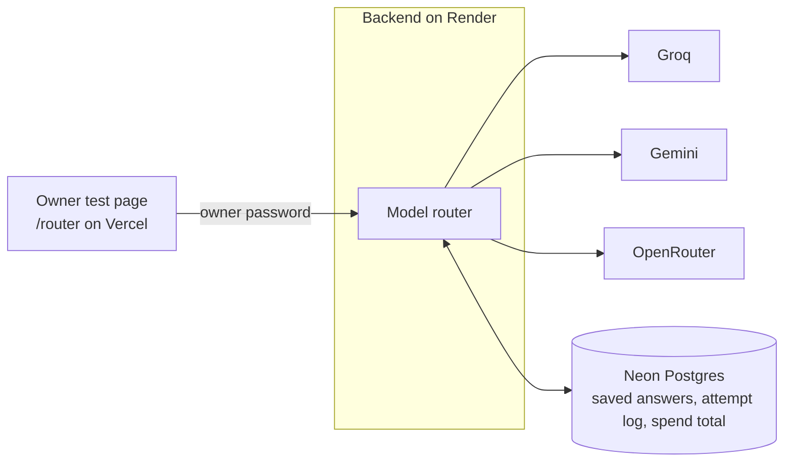
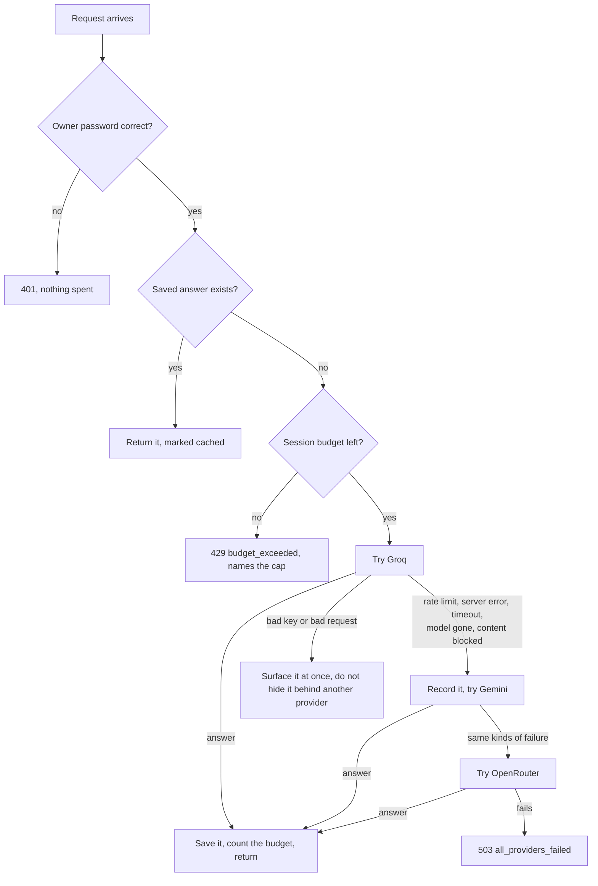

# M1: Model router

**Status: built and verified locally, including against the three real providers with real keys (2026-10-19). Deployment to Render and your live check are pending.** This document records what M1 is, how it works, how to set it up, and how to check it. It describes M1 only and will be updated as later milestones change things.

Related documents: [M0 setup](M0-setup.md) · [Milestone plan](Redflag_Milestones.md) · [M1 design](superpowers/specs/2026-10-19-m1-model-router-design.md) · [M1 build plan](superpowers/plans/2026-10-19-m1-model-router-plan.md)

## 1. What M1 is for

Later milestones will ask AI models thousands of questions: the demo bots answer attacks, a judge rules on unclear cases, an assistant interviews the developer. Redflag runs on free model tiers, and those allow only a small number of requests that can run out without warning.

M1 builds the **switchboard** that keeps this from breaking a scan: one interface to several AI services, automatic fallback between them, saved answers for repeated questions, and hard limits per session. Nothing is attacked or scanned in M1. That starts in M2 and M3.

## 2. How it works

### 2.1 Where it sits

### 2.2 What happens to one request

Cached answers cost nothing and never count against the budget.

### 2.3 The parts

| Part | What it does |
|---|---|
| **Provider adapters** | One per service (Groq, Gemini, OpenRouter), written on plain `httpx`. They turn every reply into either an answer or a typed error, and never copy a provider's error text (it could echo a key) |
| **Router** | Tries providers in order, records every attempt, cools down a rate-limited provider, and never reports a failure as a success |
| **Saved answers (cache)** | Stored in Neon. Only temperature-0 requests are saved. They expire after 7 days and are capped at about 50 MB, oldest dropped first |
| **Session budgets** | Per session: requests, text (tokens), time and parallel calls. Extra parallel calls wait their turn. Hitting any cap stops the session cleanly. Held in memory, so a restart resets them |
| **Attempt log** | One row per attempt in Neon (who was asked, what happened, how much it used). Trimmed to the latest 5,000 rows. No prompts or answers are stored in it |
| **Paid path** | Off by default. Needs a switch **and** a spending cap above zero. Results are labeled paid, and the spend total lives in Neon so a restart cannot reset the cap |
| **Owner lock** | Every router endpoint needs the `X-Owner-Token` header. With no `OWNER_TOKEN` set, they are locked for everyone |

### 2.4 Error kinds you can see

| Outcome | Meaning | Falls back to the next provider? |
|---|---|---|
| `ok` | Answered | n/a |
| `cache_hit` | Served from saved answers | n/a |
| `rate_limited` | Provider says too many requests | Yes, and it is skipped for its retry time (60 s if none given) |
| `server_error`, `timeout` | Provider broken, slow or unreachable | Yes |
| `model_unavailable` | The model is gone, or out of credits | Yes |
| `content_blocked` | A safety filter declined to answer | Yes (and recorded, so a block is never mistaken for an answer) |
| `unexpected_error` | A bug in an adapter | Yes (logged by type only, never by message) |
| `simulated_rate_limit` | The owner pressed "pretend out of quota" | Yes (labeled so it can never be mistaken for a real outage) |
| `auth_error` | A key was rejected | **No.** Shown at once, naming the provider |
| `bad_request` | The request itself was invalid | **No** |

### 2.5 Endpoints

All need the `X-Owner-Token` header.

| Endpoint | Purpose |
|---|---|
| `POST /llm/chat` | Ask a question. Returns the answer, provider, model, cached and paid flags, every attempt, token usage and the remaining budget |
| `GET /llm/providers` | Who is configured and who is cooling down. Never shows keys |
| `GET /llm/calls` | The recent attempt log |
| `POST /llm/test/fail` | Pretend a provider is out of quota for a while |
| `POST /llm/test/clear-cache` | Clear the saved answers |

### 2.6 The test page

`/router` on the frontend is an owner-only test tool. It is not linked from anywhere and is marked "noindex". You unlock it with the owner password, which is checked against the backend straight away and kept in memory only, never stored in the browser or put in a URL. It shows each answer's provider, model, memory and paid labels, the budget meter, the attempt log with a "Switched from X to Y" notice, provider status, buttons to pretend a provider is out of quota, a button to clear the saved answers, and a button to start a new session (new budget).

**Each message is sent on its own by default,** so asking the exact same thing twice is an identical request and is answered from memory. Tick "Keep the conversation" to send earlier turns along too; the history then makes every request different, so repeats are not remembered in that mode.

## 3. Setting it up

### 3.1 Settings (in Render's environment settings)

| Variable | Secret? | Purpose |
|---|---|---|
| `OWNER_TOKEN` | **Yes** | The password for the router endpoints and `/router`. Use a long random string |
| `GROQ_API_KEY`, `GEMINI_API_KEY`, `OPENROUTER_API_KEY` | **Yes** | One per provider. A missing key means that provider is skipped |
| `GROQ_MODEL`, `GEMINI_MODEL`, `OPENROUTER_FREE_MODELS` | No | Model names. They change often, so check each provider's current list. Defaults are in `backend/.env.example` |
| `ALLOW_PAID_MODELS`, `PAID_SPEND_CAP_USD`, `OPENROUTER_PAID_MODEL` | No | The paid path. Off unless both the switch and a cap above zero are set |
| `CACHE_TTL_SECONDS`, `CACHE_MAX_BYTES`, `BUDGET_MAX_*` | No | Tuning, with safe defaults |

Free keys: Groq (console.groq.com), Gemini (Google AI Studio), OpenRouter (openrouter.ai). None needs a card. Real values go only into Render's settings and your local git-ignored `.env`.

### 3.2 Database

Two new migrations create the saved-answers, attempt-log and spend tables. They run automatically when the backend deploys.

## 4. How it was tested

| Where | What | Tests |
|---|---|---|
| Backend over HTTP, real Postgres, fake providers | Owner lock (even with a malformed body), fallback on every failure kind, no fallback on a bad key or request, total failure is never a success, unconfigured providers skipped, cool-off, cache hit/expiry/size cap, every budget cap including parallel calls, attempt log, pretend-failure and clear-cache tools, provider status, paid path (off by default, labeled, capped, cap survives a restart), unexpected crashes never leak their message | 42 |
| Provider adapters against sample HTTP replies | Exact request shapes, reply parsing, every error classification, blocked and empty replies, network trouble, keys never in errors or printouts | 55 |
| Test page as a rendered page, network faked | Locked state, wrong password, unlock, labels, budget meter, attempt log and switch notice, each failure message, provider status, test buttons, password never stored, one message per request by default, conversation mode, new session | 21 |

No test in CI calls a live provider. The cache rules and the concurrency cap were each proven to be caught by their tests by breaking them on purpose and watching the tests fail.

A rehearsal of the live acceptance steps was also run against the real router with the owner's real keys and a local Postgres: wrong password refused, a real Groq answer, the repeat served from memory, "pretend Groq is out of quota" switching to Gemini with the switch logged, a one-request budget stopping the second request, and no key or password in any response or log.

A local end-to-end run with the real backend, real Postgres and fake providers confirmed the browser's preflight check is allowed from the frontend and refused from any other site, a wrong password gets 401, a rate-limited provider falls back to the next, and a repeat is served from the cache.

## 5. Problems met

| Problem | Cause | Fix |
|---|---|---|
| The production build failed on the test page | A random session id made while rendering would be frozen into the pre-rendered page for every visitor | The id is made on the first send, in an event handler |
| mypy rejected the provider interface | The interface declared `configured` as writable while the adapters expose it read-only | The interface declares it read-only |
| Gemini reports a bad key as a 400 | It uses an "invalid argument" status with a reason string | The adapter reads the reason and reports an auth error |
| A tokenless request returned 422 on the live site | My PowerShell quoting mangled the test body | Verified locally and live that the lock is checked before the body, and added a test |
| The first real Groq call failed: model not found | The default `llama-3.1-8b-instant` is not available on the owner's account. Groq's own list for the key showed `openai/gpt-oss-20b`, `openai/gpt-oss-120b` and a few others | The default is now `openai/gpt-oss-20b`. This is why model names are settings |
| The first real OpenRouter call reported a rate limit | One free model was rate limited at its upstream provider (Google), while the next free model answered fine. The adapter had wrongly assumed one limit covered every free model | The adapter now tries the next free model after a rate limit, and only reports a rate limit when every free model is limited. The old test encoded the wrong assumption and was replaced |
| On the live site, asking the same question three times never showed "From memory: yes" | The page sent the whole conversation each time, so the second request differed from the first. My local rehearsal sent single messages and missed this | Each message is now sent alone by default, with an opt-in conversation mode and a "Start a new session" button. Found by the owner's live check |
| Reasoning models can return an empty reply on a small output cap | They spend the token cap thinking before they write an answer (seen with an OpenRouter free model at 16 tokens) | An empty reply is treated as a failure, never a blank answer. The default output cap is 512 tokens, which leaves room. Raise it if replies come back empty |

## 6. Checking it on the live site (your acceptance)

Needs the three free keys, `OWNER_TOKEN` and a backend redeploy.

1. Open `/router` on your Vercel address. It starts locked. A wrong password is refused.
2. Unlock with the right password. Provider status shows which providers have keys.
3. Ask a real question and see the answer, the provider and model that gave it, and the budget meter.
4. Ask the exact same question again and see "From memory: yes". (Leave "Keep the conversation" unticked, so the second request is identical to the first.)
5. Press "Pretend groq is out of quota", ask something new, and see "Switched from groq to gemini" in the attempt log.
6. (Optional) Check that a tiny budget stops cleanly and the page says which cap was reached.

## 7. Limits to know about

- **Budgets, cool-offs and pretend-failures live in memory.** A Render restart (including the idle sleep) resets them. The saved answers, attempt log and paid-spend total live in Neon and survive.
- **The free keys have small quotas that change often.** The router exists so that is survivable, not so that quotas disappear.
- **Model names are settings, not code,** because free model lists rotate. If a provider says a model is unavailable, update the setting.
- **Saved answers include prompts and answers from the test page.** They are only reachable by the owner and expire after 7 days. Retention controls arrive in M10.
- **Not built yet:** the "paste your own API key" box for visitors, streaming replies, tool calling through the router, and the dashboard. Those come in later milestones.
