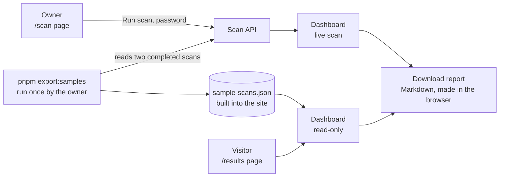

# M4: Dashboard and reports

**Status: built and tested, waiting for the deploy and the owner's check on the live site.** This document records what M4 is, how it works, how to save the public sample scans, and how to check it. It describes M4 only and will be updated as later milestones change things.

Related documents: [M3 setup](M3-setup.md) · [M2 setup](M2-setup.md) · [Milestone plan](Redflag_Milestones.md) · [M4 design](superpowers/specs/2026-10-20-m4-dashboard-design.md) · [M4 build plan](superpowers/plans/2026-10-20-m4-dashboard-plan.md)

## 1. What M4 is for

M3 gave Redflag a scan engine and a plain list of results. M4 makes those results understandable to someone who has never seen the product: charts, a conclusion that never overclaims, a table of every test, the full conversations, a comparison of two scans, a history, and a downloadable report.

It serves two audiences with one dashboard. **The owner** runs live scans on `/scan`. **A first-time visitor** opens `/results` and sees saved real scans of the weak and the hardened bot in the same dashboard, with no way to start a scan, because a live scan uses the bots' small free AI quota.

## 2. How it works

### 2.1 The big picture



The public page reads only the file built into the site. It makes no network request, so it costs no AI quota and nobody can run up your usage.

### 2.2 The tabs

| Tab | What it shows |
|---|---|
| **Overview** | The conclusion, a donut chart of the results, a bar for each of the ten OWASP risks, the critical failures, and the settings the scan ran with |
| **Tests** | A table of every test: result, risk, severity and the model that answered. Filter by result, risk or severity, and sort the most serious first |
| **Conversations** | For each test: the message sent, the reply, the tool-call log with arguments, the evidence, the rule, a short "how to fix this" note and the model |
| **Compare** | Pick another scan. Shows the failure counts, which tests changed result, tests in only one scan, and whether the **same AI model answered both** |
| **History** | Every earlier scan, with its failure count. Opening one loads it into the dashboard |

There is also a **Download report** button on every scan.

### 2.3 Colours and words

Colour is never the only signal. Every status keeps its word.

| Status | Colour | Word |
|---|---|---|
| pass | green | PASS |
| fail | red | FAIL |
| inconclusive, error | yellow | INCONCLUSIVE, ERROR (one "unclear" slice in the chart) |
| not applicable, not tested | grey | NOT APPLICABLE, NOT TESTED |

The colours adapt to dark mode. An untested risk is **grey**, never green. A risk bar is stacked by status, so a risk with one pass and one error shows a green part and a yellow part.

### 2.4 The conclusion

The conclusion states counts first and never gives a verdict on the bot. For example: "4 of 11 attack tests failed, 2 of them critical." It then says, where they apply:
- the attack success rate with a 95% range, and "this is a small sample" under 20 tests
- how many tests could not be completed
- how many normal requests worked
- how many of the ten risks have no pass or fail result

It always ends: "This is not a guarantee of security. It only reports what these tests checked." The words "safe", "secure" and "ready" never appear, and a test enforces that.

The banner colour follows the same honesty. It is red if anything failed, **yellow** if nothing failed but some tests were unclear or some risks were not tested, and green only when none of that is true, so an incomplete scan can never look like an all-clear.

**Attack success rate** is the attack tests that failed out of those that ended pass or fail. Errors, inconclusive and not-applicable tests are left out of that count and shown beside it. Normal requests are never part of it.

### 2.5 Severity and fix notes

Each attack test in the test library (`suite-v2.json`) has a **severity** (critical, high or medium) and a short plain **how to fix this** note. Both are saved with each result when the scan runs, so a result stays a faithful record even if the library changes later. Scans from before M4 (such as scan 1) have neither and show "not rated". **You can edit severity and the notes in the test file**; there is no in-app editor.

### 2.6 Comparing two scans

Compare says "the same model answered both scans" only when both scans' lists of models are identical. If they differ (including when a rate-limit fallback mixed models inside one scan), it names the models and warns that the difference may not come from the defenses. It also says when the two scans ran different versions of the test library, and lists tests that appear in only one.

### 2.7 The report

A Markdown file built in the browser from the scan: the conclusion, the settings, every test with its result, the failures (with severity, evidence and how to fix), what could not be decided or completed, what did not apply, and the risks that were not tested. It ends with the not-a-guarantee line.

### 2.8 The public sample scans

The public page shows two saved scans, one weak and one hardened. Until you save them it says "No saved scans yet." To save them:

1. On the live site, run a scan of the weak bot and one of the hardened bot, and note the two scan numbers.
2. From the `frontend` folder run:

   ```powershell
   pnpm export:samples --weak <weak scan number> --hardened <hardened scan number>
   ```

   It reads your owner password from the git-ignored `.env.local`, asks the live API for the two scans, and checks them against the rules in `scripts/sample-rules.mjs`. It refuses to write the file if a scan is not completed, if there is not exactly one weak and one hardened scan, if a result has no evidence or a verdict with no model, or if anything is shaped like a key, token or connection string. It prints only scan numbers and model names.
3. Commit the changed `src/data/sample-scans.json` and push. Vercel rebuilds the public page.

The random fake `CANARY-` secrets that a leak test shows are allowed in the file. Every saved scan is labelled "Recorded on [date] with [model]".

## 3. Setting it up

One new database migration (`e5f607182930`) adds two nullable columns for the severity and fix note. The Docker image runs `alembic upgrade head` on start, so deploying applies it. There are no new settings and no new keys.

## 4. How it was tested

Only at the five agreed seams. The only faked part is the outside model.

| Seam | What it covers | Tests |
|---|---|---|
| Dashboard, network faked | the conclusion wording and banner colour, the chart's text version, grey for untested risks, critical failures, the tabs and keyboard, table filters and sorting, conversations, Compare, History, the report download, no network request | 23 |
| Analytics, comparison and report functions | counts and slices, risk bars, critical failures, success rate and the Wilson range, small-sample note, the conclusion and its banned words, banner colour, comparison wording, the Markdown report | 30 |
| Scan API over HTTP, real Postgres | severity and fix notes saved and returned, and a result saved before M4 still readable (plus the M3 scan tests) | 29 |
| Test library file | every attack test has a severity and a fix note, normal requests have neither, the serious ones are critical (plus the M3 library tests) | 9 |
| Saved sample file | the rules (completed scans, one weak and one hardened, evidence, models, nothing key-shaped) and the committed file | 9 |
| Public results page | the empty state, the saved-not-live label with date and model, no run button, Compare ready as weak versus hardened, switching scans, no network request | 6 |
| Scan page (owner) | locked state, run and progress, the free-tier wait note, opening the dashboard, interrupted scans, plain errors, earlier scans and Compare with the password | 9 |

Two deliberate breaks proved the key rules: counting a risk with no tests as fully green, and a conclusion that said the bot "looks safe to release". Each made its test fail. No test in CI calls a live model.

## 5. Problems met

- **A variable reassigned while drawing.** The donut kept a running position in a variable. The React lint rule rightly refused it, so each slice's start is now worked out up front.
- **Two matches for one name.** A public-page test looked up the bot's name, which appears in the header and in the settings box, so it found two. The test now checks the scan's heading.
- **The old scan-page tests.** They tested the plain result list that the dashboard replaced. They were rewritten for the new layout, and the detailed result checks now live in the dashboard's own tests.

## 6. Checking it on the live site (your acceptance)

1. Confirm the deploy: Render shows **Live** on the newest commit, and its log shows "Running upgrade d4e5f6071829 -> e5f607182930".
2. Open `<your site>/scan`, unlock, and run a scan of the **weak** bot, then one of the **hardened** bot. (Or ask me to. Each uses 40 to 80 of the bots' free calls.)
3. When a scan finishes, the dashboard opens. Read the Overview: the conclusion, the donut, the bars, the critical failures. Check that untested risks are grey and nothing says the bot is safe.
4. Open the Tests tab, filter to failures, then open Conversations and read one finding with its evidence and "how to fix".
5. Open Compare and compare the two scans. Read the line about whether the same model answered both.
6. Press **Download report** and read the file.
7. Save the public samples: `pnpm export:samples --weak <n> --hardened <n>`, commit and push.
8. Open `<your site>/results` in a private window, with no password. Check it shows the saved scans, says they are saved and not live, has no Run scan button, and that Compare opens ready.

## 7. Limits to know about

- **The public page is a replay.** It shows two saved scans, not live ones, and says so.
- **Attack success rates rest on few tests.** With 16 tests, a rate is a rough guide, and the page says so under 20.
- **A comparison is only fair if the same model answered both scans.** Free-tier limits can switch models mid-scan, and the page says when that happened.
- **Severity and fix notes are my first pass.** Edit them in the test file.
- **Scans from before M4** show "not rated" severity and have no fix note.
- **History is a list**, not a trend chart. No PDF export, accounts or scheduling.
- **Only the owner can run a scan**, and only the demo bots can be scanned.

## 8. What M4 achieved

- A dashboard with an Overview, a Tests table, Conversations, Compare and History, and a Markdown report.
- A conclusion and colours that never overclaim: counts first, untested risks grey, and no "safe", "secure" or "ready".
- A severity and a fix note on every attack test, saved with each result.
- A comparison that says whether the same AI model answered both scans.
- An owner page with a live progress view, and a public page of saved real scans that makes no network request.
