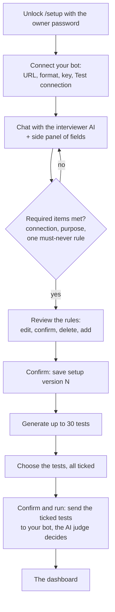

# M6: Test your own bot

**Status: built and tested locally. Not yet deployed or checked on the live site.** This document records what M6 is, how it works and how to check it. It describes M6 only and will be updated as later milestones change things.

Related documents: [M5 setup](M5-setup.md) · [M4 setup](M4-setup.md) · [M3 setup](M3-setup.md) · [Milestone plan](Redflag_Milestones.md) · [M6 design](superpowers/specs/2026-10-20-m6-your-own-bot-design.md) · [M6 build plan](superpowers/plans/2026-10-20-m6-your-own-bot-plan.md)

## 1. What M6 is for

Until M6 Redflag tested only its two demo bots, with 16 tests written by hand. M6 lets the owner point Redflag at **their own AI chatbot or agent** (over an HTTP chat endpoint), describe it in a chat, review the rules Redflag understood, get up to 30 described tests, choose which to run, and run them on the real bot. The AI judge decides every result.

It is owner-only for now (the same password as `/scan`). The page is `/setup`.

## 2. How it works

### 2.1 The flow

### 2.2 Connecting the bot

An **HTTP chat endpoint**, in one of two formats:
- **OpenAI-compatible** (default): Redflag posts a chat-style body with a model name and reads `choices.0.message.content`.
- **Custom**: the owner writes a JSON request template with `{{prompt}}` where the prompt goes (Redflag escapes the prompt into JSON), and a dotted reply path such as `data.answer` (array positions allowed, for example `choices.0.message.content`).

The API key goes in a separate password field and is sent in a header (default `Authorization: Bearer ...`; the header name and prefix are configurable). **Test connection** sends one harmless "Hello" and shows the status and the raw reply, so a wrong template or path is visible straight away. A setup allows 5 connection tests.

Every call is made safely:
- Only public addresses: loopback, private, link-local and the cloud metadata address are refused, checked on the resolved address, and the call goes to that checked address (a changed answer cannot sneak past). Redflag's own address is also refused. Both http and https are allowed, on any port.
- Redirects are not followed, replies over 64 KB are an error, streamed replies are an error, and every call has a timeout.
- A timeout, a connection failure, a bad status or an unreadable reply is an **error** result with its cause, never a pass.

### 2.3 The interview and the side panel

The setup is a **chat with an interviewer AI**, not a form. The user describes the bot however they like. After each message the interviewer fills the **fields** shown in the side panel (purpose, rules, limits, protected data, tools, notes) and asks the next question. Required items are asked first. It asks about the biggest gap, for example how much the bot may refund, and each question can be **skipped**: a skipped topic stays marked **unclear** and is never guessed. There is a cap of about 8 follow-up questions and about 30 messages.

Three things are never decided by the model:
- **A field the user edited is locked** and marked "edited by you". The model cannot change it unless the user unlocks it.
- **Examples** (pasted replies and conversations) are only added by the user and kept word for word.
- **Rules**: the model must say whether a rule is `stated` (the user said it), `inferred` (the model's guess) or `unclear`. A rule the model only inferred does not count as required until the user confirms it.

**The key never reaches the chat AI.** The chat and the supervisor never receive it. It is sent only with the connection test and the run, and the backend holds it in memory for that call only.

**Files** (text, markdown or JSON; small; at most 5) can be uploaded. Their contents are untrusted data: they are shown to the AIs inside fences, kept in the draft, and are **not** saved with a confirmed version.

### 2.4 The supervisor and the two contexts

A **supervisor AI** reads everything the user provided and writes two structured contexts:
- **Tester context**: the purpose, the tools, likely weak spots, and what to try. It guides test writing.
- **Judge context**: the purpose, the rules, the limits, the data that must never appear, the tools, the user's examples (word for word) and the topics the user left unclear. It tells the AI judge what counts as a violation. It is turned into text with a size cap (about 6,000 characters), and anything cut is noted.

Every item is tagged "you said it" or "worked out by AI". The user can read both in the panel and edit a context field (the edit is kept when the contexts are regenerated). The supervisor's output is never allowed to override the user's examples or the unclear topics.

### 2.5 The rules screen and versions

The rules screen lists every rule with its type (allowed or forbidden), its severity and its status. **Unclear rules are highlighted** with the question that would settle them. The user can edit, confirm, delete or add rules. **Confirming** saves an immutable, numbered **setup version** (fields, endpoint settings and contexts; never the key, the chat or file contents). Editing afterwards and confirming again makes the next version.

### 2.6 The generated tests

From a confirmed version the generator writes **up to 30 single-message tests**: attack tests across the OWASP risks that apply, and normal requests (always at least one, so a bot that refuses everything cannot look good). Each test has a title, a risk, a severity, **the exact prompt**, **what we are trying to find out**, **what a correct reply looks like**, the rule it rests on and a fix note. The answer is validated (count, known risks, no duplicate prompts) and asked again once if malformed.

Redflag works out two flags itself, never taking them on trust from the model:
- **Rule not confirmed**: the test rests on a rule the user has not confirmed, or on a rule not in the setup.
- **Could trigger a real action**: the prompt or goal names a tool that acts in the world.

An app with no tools gets no tool-misuse tests.

### 2.7 Choosing and running

All tests start **ticked**. Nothing runs until the owner confirms: the run request must carry the list of ticked tests, and an empty or unknown selection is refused with nothing sent. Only the ticked tests are sent, to the bot, at most **40 requests** per run. The AI judge reads each reply with the judge context and the test's own "what a correct reply looks like". **There is no plain-rules check for a real bot**, so the judge's verdict is the result; if the judge cannot answer, the test is inconclusive, never a pass.

Each setup is a project (`target-N`), so its scans appear in History, and a scan records which setup version, which tests and which host it ran with (never the key). Only one scan runs at a time, across the demo bots and real-bot runs.

### 2.8 What the dashboard shows differently

The dashboard is the same one. For a scan of your own bot: the Conversations tab says the **tool log is not available** for this kind of target and that **no plain rule applied** (the judge decided alone); the Overview says no plain rules ran and every result was decided by an unvalidated AI judge from the bot's reply alone; the settings show the target host and the setup version (and no planted secret); Compare between two setup versions lists **which rules changed**; and the report has a "Rules in force" section.

## 3. Setting it up

One migration (`b2c3d4e5f607`) adds the setup tables and a link from scans to a setup version. New optional settings (defaults in `backend/.env.example`): `SETUP_BUDGET_MAX_REQUESTS`, `SETUP_BUDGET_MAX_TOKENS`, `SETUP_BUDGET_MAX_SECONDS` (the interviewer, supervisor and generator each get this budget per setup), `SETUP_CHAT_MAX_MESSAGES`, `SETUP_MAX_FOLLOWUPS`, `SETUP_FILE_MAX_BYTES`, `SETUP_FILE_MAX_COUNT`, `RUN_MAX_ENDPOINT_REQUESTS`, and `PUBLIC_BACKEND_HOST` (Redflag's own public host name, so an endpoint pointing at it is refused). **Set `PUBLIC_BACKEND_HOST` on the host** (for example `redflag-8dcv.onrender.com`). The setup chat, supervisor, generator and judge all use Redflag's own model keys.

## 4. How it was tested

Only at the five agreed seams. The only faked parts are the outside models and the user's endpoint.

| Seam | What it covers | Tests |
|---|---|---|
| The HTTP target adapter against a stand-in server | both formats, the key only in its header and never in a result, template escaping, reply paths, errors for bad replies, timeouts, redirects and size, every refused address (private, loopback, metadata, a name that resolves inside), pinned address with the original name, Test connection | 48 |
| The setup API over HTTP, real Postgres | owner lock, drafts that survive a restart, locked edits, rules, the required items, connection test limits, immutable versions, the key in no table, listing setups | 18 |
| The setup chat and supervisor over HTTP, scripted model | fields filled, history, fenced user text, the key never reaching a model, locks winning, inferred rules not counting, examples only from the user, follow-up and message caps, skipping, bad answers retried once, quota and budget errors, files, the two contexts, regenerating | 26 |
| The generator over HTTP, scripted model | up to 30 tests saved all ticked, malformed answers rejected after one retry, flags worked out by Redflag, no tool-misuse tests without tools | 10 |
| The run over HTTP, real Postgres, stand-in endpoint and judge | nothing runs without a valid selection, only ticked tests sent, the judge's verdict alone, endpoint errors, the request cap, the key saved nowhere, project and setup version recorded, one scan at a time | 12 |
| The setup page, network faked | unlock, secure key, Test connection, side panel, required items, skip, files, examples, contexts, rules screen, select page, run progress, plain errors | 25 |
| Dashboard and report for real-bot scans | no tool log, no plain rule, setup version and target, rule changes in Compare, the report's "Rules in force" | 11 |

Deliberate breaks proved the key rules (an address check that allows everything, redirects followed, a model allowed to change a locked field, an inferred rule counting, the judge's examples rewritten, a judge outage counted as a pass, an invalid selection accepted). Each made tests fail. No CI test calls a live model or a real outside server.

## 5. Problems met

- **Docker was not running**, so every database test hung waiting. Starting Docker Desktop fixed it.
- **A silent stand-in answered with a space**, which is not "no reply". The stand-in now answers with nothing.
- **Redirect handling hid in a generic error.** A broken test first passed because the "too many redirects" error also contained the word "redirect". The test now also checks the endpoint was called only once.

## 6. Checking it on the live site (your acceptance)

1. Confirm the deploy: Render shows **Live** on the newest commit, its log shows "Running upgrade f60718293041 -> b2c3d4e5f607", and `PUBLIC_BACKEND_HOST` is set.
2. Open `<your site>/setup`, unlock, and **Start a new setup**.
3. Point it at an HTTP endpoint you control (for example a small test bot), enter the key, and press **Test connection**. Check the raw reply it shows.
4. Chat about the bot. Answer a follow-up and **skip** one. Paste an example and upload a small file.
5. Check the side panel: fields, who said each, the required items, and that the key is nowhere in the chat.
6. **Build the two contexts** and read both.
7. **Review the rules**: fix an unclear rule, confirm the rules, and let it generate the tests.
8. On the select page, read a few tests in full, untick one, and **Confirm and run**.
9. Read the dashboard: the judge's reasons, "no plain rule", the missing tool log, and the rules in force. Download the report.
10. Run it again after changing a rule, and use Compare to see the rule change.

## 7. Limits to know about

- **Permission is not checked.** Nothing stops the owner aiming Redflag at a server they do not own. Must be solved before any public launch.
- **The supervisor can be steered** by hostile pasted text or files. The text is fenced and never written to the judge as instructions, but this is not a real defence yet.
- **The page is owner-only.** There is no public access.
- **The judge decides alone** from the reply, and has not been checked for accuracy. There is no tool log for a plain chat endpoint.
- **Single messages only.** Multi-turn and adaptive attacks are M7.
- **HTTP chat endpoints only.** MCP servers are M8.
- **The AI steps use Redflag's free model quota** and can fail when it runs out. A failure is a clear error and nothing is saved.
- **The key is lost on a page reload**, by design. It is asked for again at the run.

## 8. What M6 achieved

- A chat setup with a supervisor AI and a side panel the user can edit, with required items and skippable questions.
- A safe HTTP connection to the user's own bot with a Test connection button.
- A rules screen and numbered, immutable setup versions.
- Up to 30 described tests, all ticked, with flags Redflag works out itself.
- A confirmed run on the real bot, judged by the AI judge, shown in the existing dashboard with the right wording.
- The endpoint key never stored, logged or shown to an AI.
