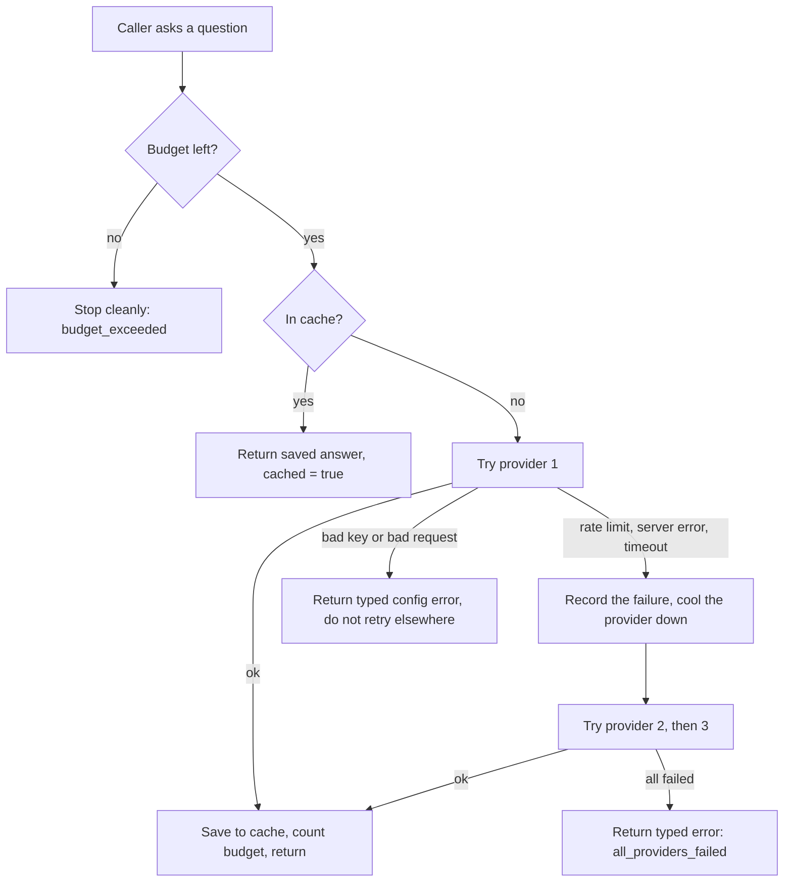

# M1: Model router: design

Status: draft for approval. Date: 2026-10-19.
Builds on: [M0 setup](../../M0-setup.md). Milestone definition: [Redflag_Milestones.md](../../Redflag_Milestones.md), section M1.

## Intent and why

Later milestones need many model calls: the demo bots answer attacks, a judge rules on unclear cases, an interview assistant asks the developer questions. Redflag runs on free model tiers whose quotas are small, change often and run out without warning (checked 2026-10-18: Gemini roughly 5 to 15 requests a minute and 100 to 1,500 a day depending on source; Groq about 30 a minute and 1,000 a day on most models; OpenRouter free models 20 a minute and 50 a day, or 1,000 a day after $10 of lifetime purchases).

A scan that dies because one quota ran out wastes the owner's time and, worse, could be mistaken for a result. M1 builds the switchboard that keeps scans alive and cheap: one interface to several providers, automatic fallback, a cache, and hard limits per scan. It is infrastructure. Nothing is attacked or scanned in M1.

Spec items: FR-44 (provider abstraction), FR-45 (fallback, recorded), FR-46 (request caching), FR-47 (budget controls), NFR-05 (reliability), NFR-10 (cost control).

## Goals

- One internal interface for asking a model a question, whichever provider answers.
- At least two real providers working: Groq and Gemini, plus OpenRouter as a third and the paid backstop.
- Automatic fallback when a provider is rate-limited, down or slow, with every switch recorded.
- A cache so an identical repeated request is answered without calling a provider.
- Per-scan budgets on requests, tokens, time and concurrency, with a clean stop when one is hit.
- A locked test page (owner only) that shows which provider answered, whether the answer came from cache, the switch log and the remaining budget, with a way to simulate a failure.
- Costs near zero by default, with a capped, clearly labeled optional paid path.

## Non-goals

No attacks, scans, targets, judge, policy builder or demo bots. No visitor "paste your own API key" box (a later milestone). No public chat. No streaming of replies, no embeddings, no tool calling through the router (add when a milestone needs them). No user accounts. No dashboard (M4).

## Anti-goals (a failure even if it technically works)

- A provider error, timeout or exhausted budget ever being treated as a successful answer. Failures stay visible and typed, never silently passed (this is the same rule as FR-30 for scans).
- A strange visitor spending the owner's free quota or paid credit.
- An API key appearing in the repo, a log line, an error message, a response or the browser bundle.
- The paid path being used without the owner explicitly switching it on, or without a hard cap.
- A cached answer being passed off as a fresh one, or an answer's provider and model going unrecorded.

## Decided by the owner

- Build order stays one milestone at a time, deployed and checked before the next.
- Provider order: Groq free, then Gemini free, then OpenRouter as the backup. (OpenRouter as the backup is the owner's agreement to option B; the exact order is a recommendation they accepted.)
- Cost approach is **option B**: start free-only. The roughly $10 OpenRouter credit is optional and bought later. The owner confirmed their card works for online dollar payments.
- The test chat page is **locked: only the owner can use it**, behind a secret password.
- The "paste your own API key" box is **not** in M1.
- The switchboard stays small: one main provider, one spare, strict budgets, switching as the exception.

## Constraints

- Free hosting: the Render backend sleeps when idle and restarts lose memory. Anything that must survive a restart (the cache, the call log) goes in Neon. Anything per-session (live budget counters, provider cool-downs, test-failure switches) lives in memory and resets on restart. A scan that straddles a restart is marked stopped, not continued with wrong numbers.
- Neon free plan: 0.5 GB of storage. The cache must have a hard size limit and an expiry.
- Keys are only ever read from the backend host's environment settings.
- Free model names and limits change often. Model names are configuration, checked live with real keys at build time, never hard-coded in logic.
- Python 3.12, FastAPI, httpx (async), SQLAlchemy and Alembic, as in M0.

## Design

### Request flow

### Parts

- **Provider interface.** One adapter per provider. Each takes a provider-neutral request (messages, temperature, max output tokens) and returns a provider-neutral answer (text, model used, tokens in and out, latency) or raises a typed error: `rate_limited` (with retry-after when given), `server_error`, `timeout`, `auth_error`, `bad_request`, `model_unavailable`. A provider with no key configured is "not configured" and skipped.
- **Router.** Walks the provider list in order. Falls back only on `rate_limited`, `server_error`, `timeout` and `model_unavailable`. It never falls back on `auth_error` or `bad_request`, which are the owner's configuration problems and must surface. A provider that was rate-limited is cooled down for the retry-after time (or a default) so later calls skip it.
- **Cache.** Keyed on the content of the request (messages and settings), not on the provider, so any provider's answer can be reused. The saved entry records which provider and model produced it. Only requests with temperature 0 are cached (a random answer would be wrong to reuse). Stored in Neon with an expiry and a hard size cap, evicting oldest first.
- **Budgets.** A budget belongs to a "session" (in M1 a chat session, later a scan). Caps: number of requests, tokens in plus out, wall-clock time, and concurrent calls. Concurrency is bounded with a semaphore. Checked before each call and counted after, using provider-reported tokens where available. Hitting any cap ends the session with a typed `budget_exceeded` that names the cap, never a crash.
- **Attempt log.** Every attempt (provider, model, outcome, latency, tokens, cached or not) is returned with the answer and stored in Neon. This is the record behind "the switch is recorded" and the reproducibility rule NFR-06.
- **Paid path (off by default).** OpenRouter can serve non-free models only when the owner sets an explicit switch in the host settings. Results from a paid model are labeled paid, estimated spend is tracked against a configured cap using per-model prices from configuration, and the router refuses to go past the cap. The credit actually bought on OpenRouter is the final ceiling.
- **Owner lock.** The router endpoints require a secret owner token, compared in constant time. `/health` stays public. Without the token the endpoints return 401 and spend nothing.
- **Test hooks (owner only).** Make a named provider fail with a simulated rate limit for a short time, and clear the cache. These are in-memory switches that reset on restart.

### Interface (shape, not final names)

- Ask: `POST` with messages, optional session id and budget. Returns the answer, provider, model, `cached`, the attempt list, token usage, whether a paid model was used, and the remaining budget. A failure returns a typed error with the same attempt list.
- Provider status: which providers are configured and which are cooling down. Never reveals keys.
- Test hooks: simulate failure, clear cache.
- All of the above require the owner token.

### Test page

A page in the frontend, not linked from the status page, with a field for the owner password (kept for the browser session only). It shows the conversation, under each answer the provider, model and cache status, buttons to simulate a provider being out of quota and to clear the cache, and a panel with the budget used and the switch log. A rough sketch agreed in the brainstorm: conversation in the middle, test buttons below it, budget and switch log at the bottom. It is a plain test tool, not the product dashboard.

### Configuration and secrets

| Variable | Secret? | Purpose |
|---|---|---|
| `OWNER_TOKEN` | Yes | Unlocks the router endpoints and test page |
| `GROQ_API_KEY`, `GEMINI_API_KEY`, `OPENROUTER_API_KEY` | Yes | One per provider. A missing key means "not configured" |
| `ALLOW_PAID_MODELS` | No | Off by default. Turns on the paid path |
| `PAID_SPEND_CAP_USD` | No | Hard cap for the paid path |
| Cache size and expiry, default budget numbers | No | Tunable without code changes |

Real values live only in the Render settings and the local git-ignored `.env`. `.env.example` lists names only.

## Testing

Two seams, as agreed for test-first work. The only faked boundary is the outside providers.

- **Seam 1, the backend over HTTP with fake providers and a real Postgres.** Covers: owner lock (wrong or missing token is rejected and nothing is spent); a simulated rate limit makes the router switch providers and the switch is recorded; a repeated identical request is served from the cache without a provider call; a failing provider never counts as success; all providers failing returns a typed error; bad key or bad request does not fall back; a tiny budget stops cleanly on each cap; cache respects size and expiry; keys never appear in responses or logs; paid path off by default and capped when on.
- **Seam 2, the test page as a rendered page with the network faked.** Covers: locked state, answer with provider and cache labels, the switch log, and the budget panel.
- **Provider adapters:** tested against sample or recorded provider responses so parsing and error classification are covered without live calls.
- **Live acceptance check (owner, manual):** with real keys, one real question answered, the same question answered from cache, and a simulated quota failure switching providers.

## Done when

From the milestone doc:

1. A simulated rate limit makes the router switch providers instead of failing.
2. A repeated identical request is served from cache without a new provider call.
3. A scan stops cleanly when its budget is reached.

Added by this design:

4. The test page and router endpoints reject anyone without the owner password.
5. No API key appears in the repo, logs, responses or the client bundle.

## Owner actions during the build

Create free keys for Groq, Google AI Studio (Gemini) and OpenRouter, and put them into Render's settings. Choose a long random owner password (the builder can generate one). Optionally buy the OpenRouter credit later. The builder says exactly what to click.

## Calls made without the owner (change any of these)

- **Owner lock is one shared secret token** in a request header, not accounts.
- **Cache only temperature-0 requests**, keyed on content and not on provider.
- **Cache limits:** 7 day expiry and about 50 MB hard cap, oldest evicted first. Fits well inside Neon's 0.5 GB.
- **Fallback only on rate limit, server error, timeout and model unavailable**, never on bad key or bad request.
- **Cooldown:** a rate-limited provider is skipped for its retry-after time, or a default of 60 seconds.
- **Budgets and cool-downs live in memory** and reset on restart. The cache and attempt log live in Neon.
- **The paid path ships in M1, off by default,** with a hard cap and labels, because adding it later is harder than building it now. If the owner prefers, this can be dropped from M1.
- **The test page lives on its own path** and is not linked from the status page.
- **Provider calls use plain `httpx`,** no vendor SDKs, so behavior stays visible and uniform.

## Left to the builder

Exact model names (verified live with the owner's keys), default budget and cooldown numbers, table layouts, endpoint names, the visual design of the test page, how provider adapters are sampled for tests, and the price table for the paid cap.
